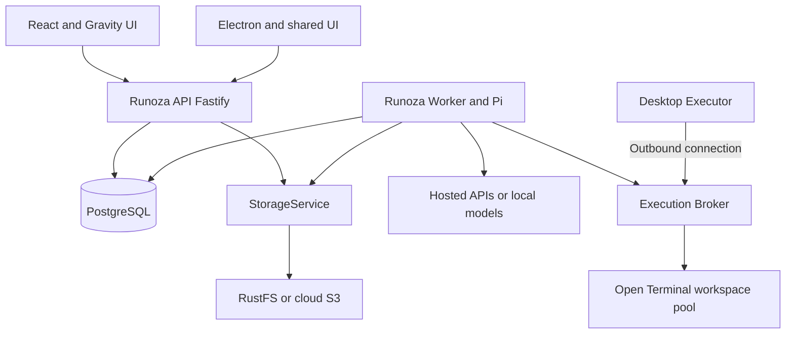

# Architecture of Runoza

Decision Date: 2026-11-11 Status: Basic architecture to implement; specific versions of libraries and images are fixed after phase 0 checks.

## Objectives and boundaries

Runoza is deployed through Docker Compose within an organization. All clients access the Runoza server; the server infrastructure accesses models and storage. Multi-user, local authorization, SSO OIDC, roles, administration, projects, chat rooms, code mode, skill hubs and MCP, and background tasks.

Image generation and editing have been removed from the current implementation plan, with a separate solution coming later, a mobile client also delayed, and web adaptability included in the current plan.

## Stack and Process Boundaries

A single TypeScript stack was selected: React and Gravity UI on the client, Node.js 24.22.1 and Fastify on the server. Go is not used in the original architecture: a separate Go API and TS runtime would add a cross-language protocol and two sets of server infrastructure without proven need.

API and worker are different processes in the same codebase. It's a modular monolith with independent process scaling, not a set of stand-alone microservices. Agent runtime is an internal worker module that integrates Pi. User code is only executed in an external executor.



Worker receives tasks from PostgreSQL via pg-boss. API reads saved startup events and passes them to clients. PostgreSQL is the source of truth; local process memory is used only as cache. Broker is the authority boundary: a separate process from the same codebase, a single component with access to container management if dynamic provisioning is enabled.

## Organization of source code

```text
apps/web                 web entrypoint
apps/desktop             Electron main process, preload, and entry point
apps/server              Fastify API
apps/worker              Background jobs and agents
apps/execution-broker    Workspace and device management
packages/app             Shared screens and workflows
packages/ui              Gravity UI components
packages/contracts       API and event schemas
packages/api-client      API client
packages/platform        Web and desktop adapters
packages/domain          Product rules and authorization
packages/db              Kysely, SQL, and migrations
packages/agent           Pi adapter and tools
packages/providers       Model connections
packages/execution       Executor contracts and adapters
packages/storage         Server-side S3 adapter
packages/jobs            Queue and schedules
deploy/compose           Compose and configuration
```

Import boundaries are checked automatically: the client does not import server packets, secrets or Node APIs. General TS types do not replace input validation during execution. Public REST API is described by OpenAPI; events are versioned independently of Pi.

## Interface and platforms

React 19.3.1, TypeScript 7.0.2, Vite 8.3.7; Gravity UIKit, AIKit, Navigation, Icons. The rest of the Gravity libraries are added according to real needs. The data and conversation state belong to Runoza, not the UI library. You need themes, keyboard navigation, adaptability, long conversations, streaming Markdown, message branching, and artifact bar.

PlatformAdapter provides a selection of files / directory, save, notifications, open the browser and register the local environment. The availability of the function is determined by the intersection of server policy, user rights and client capabilities.

Desktop: Electron as the initial choice for a common TypeScript and the same browser engine. The interface is packed locally, renderer without Node integration, with context isolation and sandbox. Preload provides narrow methods, IPC checks the sender and inputs. Arbitrary remote content does not get native access. Tauri is an alternative for a confirmed need to reduce the size of the application; its choice will require a separate ADR.

## Multilingualism

The first release supports en and ru in all user and administrative web and desktop scenarios. The language is selected in the profile; before the login - the saved device selection, then the supported browser language, then en. The interface language is independent of the model response language and timezone schedule.

Use @gravity-ui/i18n for application dictionaries and UIKit 8 Provider with lang/fallbackLang for Gravity and AIKit components. Each server query has its own language context: global setLang is prohibited on the server. API returns stable error.code and parameters, the client translates messages. Dates/numbers are formatted via Intl; UTC is stored in database. EN/RU dictionaries have the same keys, check parameters and plural forms. In the first version, no third locale is added; new strings are immediately entered in both languages.

The prototype confirmed switching its own lines and built-in lines of AIKit without rebooting. For long conversations, opt-in virtualization is enabled; the finished ChatContainer remains the prototype, the final composition is determined by product requirements.

## Authorization and management

Local accounts with Argon2id and OIDC SSO. The Web uses secure HttpOnly sessions, Origin verification, and CSRF protection. Desktop logs in to the system browser, uses a one-time code with PKCE, and a separate recall session of the device. Tokens are stored in the system's secret store. We don't implement our own cryptography, and we don't link accounts just by coincidence email without a trusted procedure.

Roles: system admin, organization admin, member. ACL resources: owner, editor, viewer. The server checks the organization and access to the resource on each operation, including SSE, terminal WebSocket and download. In the first installation, one organization, but organization_id is present in the data belonging to it. Administration does not mean the automatic right to read personal chats.

Admin: users, roles, models and providers, SSO, feature availability, quotas, audit. DB settings, secret encryption key, TLS, and trusted proxies are set when deployed. API keys are encrypted, not returned to customers, and not logged in. Individual service rights and short-lived authority limits worker and broker.

## Providers and agent

ProviderConnection, Model, ModelCapabilities, ModelAccess. Supports OpenAI-compatible endpoint and OpenRouter; LiteLLM can be an external optional gateway. It is not required in a standard Compose and is not a local model server.

Opportunities are defined by model and endpoint: streaming, tools, structured output, context limits, and other really supported operations. Chat mode works without tool calling; code mode requires tools. If Pi doesn't support a particular simple model, ProviderAdapter uses a separate normal chat path. You can't silently declare any OpenAI-compatible model suitable for an agent.

Pi connects via pi-ai and pi-agent-core. Its events are normalized: run.started, message.delta, tool.requested, approval.required, tool.completed, artifact.created, run.completed, run.failed. Built-in tools that execute code in the worker process are not used. All shell/file tools pass through ExecutionService and rights checks.

AgentRun contains the owner, project, model, versions of instructions and skills, environment, limitations, status and checkpoint. Dialogue and tool results are saved regardless of the process. Disabling the tab does not cancel the start. Cancel is a separate idempotent operation. After restart, we continue only from the confirmed border; the lost state of non-deterministic action is marked as uncertain.

## Terminal and environment

Open Terminal source tested POST /api/terminals, GET /api/terminals, GET and DELETE /api/terminals/{session_id}, WebSocket on the same path, as well as /execute. Terminal routes are hidden from OpenAPI via include_in_schema=False and depend on the availability of PTY/settings. Contract tests on a fixed image are mandatory.

The terminal session is a process/PTY within the environment. It doesn't create a container, it doesn't isolate users. So two contracts are separated.

- EnvironmentProvider: acquire, inspect, release, destroy.
- Executor: capabilities, execute, stdin, cancel, openTerminal, resizeTerminal, closeTerminal, readFile, writeFile, listFiles.

OpenTerminalAdapter is the first implementation of Executor; the backend-specific ID and URL do not enter the domain models; access checks are performed before the adapter is accessed; when the engine is replaced, the general screens and tools of the agent do not change.

The default Compose deployment uses one published Open Terminal image in native multi-user
mode. `SharedTerminalProvider` maps each organization/user pair to a stable OS account and
keeps each conversation in its own persistent home subdirectory. `OpenTerminalAdapter`
passes user/session headers for HTTP and WebSocket requests and the selected root for commands,
files, artifacts and stdio MCP. Database leases fence application requests; user/project ACL
checks remain live. Closing a lease preserves files.

This mode is for a trusted organization: accounts share a container, network and aggregate
resource limits. It does not provide isolation against hostile code. The terminal has its own
network with the worker, a persistent home volume and an automatically initialized key volume;
no Docker socket or application credentials are mounted. Stronger isolation belongs to a future
separate terminal manager behind the same provider/executor contracts.

The earlier two-slot isolated pool remains an optional backend for existing installations.
Its operator, per-conversation volumes and recycling rules are described in the
[legacy pool guide](legacy-server-pool.md). See [current server execution](server-code.md)
for the standard deployment and persistence rules.

## Desktop execution

The agent stays on the server. Desktop executor establishes an outgoing authenticated connection to the broker, logs the device and authorized workspace. Each request contains run_id, tool_call_id, device_id, workspace_id, deadline, and lease ID; the results are deduplicated.

Local rights are re-verified on the device. Host work is an explicitly authorized mode with OS user permissions, not a sandbox. Cwd restriction does not isolate the shell. Isolated local executor and host executor are shown as different capabilities.

When the device is turned off, the task waits, skips or ends according to the policy. You can not automatically change the target. The data of the read files can be transmitted to the server and the selected provider; this is reflected in the project connection interface.

## PostgreSQL and Migration

Basic entities: organizations, users, memberships, sessions, devices, projects, conversations, messages, message_parts, attachments, provider_connections, models, model_access, agent_runs, run_events, tool_calls, approvals, environments, leases, skills, skill_versions, mcp_connections, schedules,_runs, audit_events.

Messages consist of typed parts; parent_message_id supports branching. JSONB is used for extensible payload, and rights, affiliation, links, and statuses are given by explicit fields, foreign keys, and constraints. Event history has run_id and monotone sequence; client resumes SSE with cursor. Expire retention returns snapshot/resync rather than silently skipping events.

Kysely migrations are stored in a repository and executed by a separate migrate command under lock. The pg-boss application diagram and diagram have an independent version accounting and an explicit update order. All processes check the compatibility of the diagram. Changes - expand, backfill, contract. Heavy backfills are performed by renewable tasks. Clean installation and updates from the previous release are verified. Down migration does not replace backup; disruptive changes require proven recovery of databases and objects.

## S3 and file proxies

The standard Compose includes RustFS; the external storage profile uses a cloud-based S3 or other compatible endpoint. Settings: endpoint, region, bucket, credentials, TLS, path-style. Images and configuration are fixed after compatibility tests.

Any download, download, preview, Range request and deletion goes through StorageService Runoza with ACL verification. No client S3 credentials, redirect to bucket or presigned URL to S3. Browser, desktop, worker and executor receive files through the server interface; only StorageService accesses S3. Service runtime settings limit storage rights.

The transfer is streamed from backpressure, without buffering the entire file in RAM. Size restrictions, MIME, quotas, checksum and cancellation apply during transfer. Multipart is initiated and terminated by the server; unfinished downloads are cleared. Object states of pending, ready, deleting, failed reconcile database and S3 through repeatable tasks, since there is no shared transaction. Bucket is private, object key is not proof of access. Public issuance of active HTML from the main application cookies is not allowed.

## Background assignments and schedules

Local implementation of stage 8: [rules and restrictions](schedules.md): The scheduler in packages/chat starts the worker; schedule_runs stores the intentions and chat_runs stores the outbox of execution. Migration 014_schedules. Hourly/daily/weekly and manual start-up, timezone/DST, waiting for the device and explicit repeat of the unsuccessful start-up are supported.

MIT-licensed pg-boss — queue on PostgreSQL. River and its paid extensions are not used. Proprietary implementation of the queue is not required now. Domain task creation and outbox events are executed in a single transaction; dispatcher publishes a queue with a deterministic key and deduplication.

Schedules belong to Runoza: timezone IANA, usually next_run_at, misfire policy, concurrency policy, target and owner. Uniqueness (schedule_id, scheduled_at) prevents double staging; locks protect multiple scheduler. Rights are rechecked at launch. Semantics of DST and missed launches are checked by tests.

Delivery and externalities are considered at-least-once. Repetitive operations use the idempotency key. Unknown outcomes of shell command or external action are not repeated blindly.

## hubs

Skills: Instructions and resources, immutable versions, visibility personal/project/organization, author, allowed tools. Run fixes version. Involuntary npm/git plugins and scripts are not loaded inside a trusted worker.

MCP: connection registry, secrets, transport, scope, permitted tools, and audit. Remote MCP runs through the server infrastructure, stdio MCP runs in an executor environment. URLs and redirect are verified against the SSRF based on the organization's expressly authorized internal addresses. MCP authorization is separated from the Runoza sessions.

## Supply and monitoring

Compose: api, worker, postgres, rustfs, one-time migrate, and optional execution-broker/pool. API can distribute a static web build. The host publishes only the input of Runoza; the database, S3, Open Terminal and broker remain on the private network. External S3 disables local rustfs. TLS ends with a trusted reverse proxy.

You need health/readiness, request/run/tool_call correlation, structured logs without secrets, queue metrics, active launches, provider errors, and pool occupancy. API versions, schemas, and desktop protocol are aligned; a client with an incompatible protocol receives an understandable update requirement. Backup includes database, bucket, and decryption keys with a separate storage procedure.

## Sources

Exact external sources and licensing terms are listed in [Component Registry](dependencies.md). Reasons for stack selection are in [ADR](adr/0001-foundation.md). Supply sequence is in [Plan](roadmap.md).

## Stage 0 results

The exact versions and limitations are in the [dependency register](dependencies.md). Tools: npm 11.6.2 and package-lock.json instead of the original pnpm. The current Diplodoc chain requires Node 24/npm 11.5.1+. Markdown production acceptance requires separate CSP verification, sanitization and bundle size.

For the OpenRouter gpt-4.1-nano, the profile with parallel_tool_calls=false was checked; the final test through LiteLLM confirmed the free choice of the tool after correcting the metadata of the model context. The parameters must belong to the profile of the particular model, not all providers.

## Clarifications of step 0

Open Terminal creates PTY through an API; a pre-prepared PTY pool is not required. Insulation belongs to Executor/container boundary, not terminal ID. The queue uses at-least-once: outbox and long-term execution ledger to prevent the repetition of external effects.

Provider model metadata stores the real contextWindow separate from the query response limit. Too little dummy context in Pi can trim maxTokens to 1. Automated tool cycle via local LiteLLM and OpenRouter. Minimum test LiteLLM without enterprise is not approved for production: unauthorized request returned 500. All client requests still pass through the Runoza API.

Details, versions, license obligations and restrictions: [Register of Dependencies](dependencies.md).

## Implementation of the operational framework

Stage 1 introduces the server, worker, and migration apps and the contracts, API client, config, database, jobs, and storage packages. A separate migration process locks the sequence, runs Kysely and pg-boss migrations, and provisions the bucket idempotently. Startup checks the exact schema version, and readiness checks cover PostgreSQL and object storage. See the [development guide](development.md).

## Identity implementation (step 2)

Migration 003_identity adds the auth package and web entry point. Passwords use Argon2id via @node-rs/argon2. Opaque session cookies use tokens hashed in PostgreSQL. The API checks Origin and CSRF and stores rate limits in PostgreSQL. Migration 015 replaces the original OIDC implementation with Better Auth 1.7.22 and its MIT-licensed SSO package. The Runóza adapter retains PKCE, nonce and state, signature validation, and explicit issuer and subject binding. The UI is split across the app, UI, and platform packages and the web entry point. See the [identity guide](identity.md).

## Chat implementation (step 3)

Conventional text-only chat calls Pi AI via packages/providers, without agent tool loop. packages/chat stores run and events, dispatcher and pg-boss worker. `chat_runs` in queued serves outbox; re-delivery is limited to atomic claim. Providers are encrypted by a separate `PROVIDER_SECRETS_KEY`: worker does not receive identity/SSO key. SSE reads snapshots of events, rather than streaming upstream from API memory. When a worker drops, an unfinished start becomes unsuccessful without an automatic pay call. [Details and limitations of alpha](chat.md).

## Implementation of phase 4

`packages/resources` contains project/file rights, limited text extraction and file lifecycle recovery. `packages/storage` implements multipart and S3 streaming operations. Chat uses Resources for project instructions and attachment context; worker performs background cleaning. Clients receive only public metadata and the Runoza API URL. Specific roles, limitations, export and removal rules are described in [files-and-projects.md](files-and-projects.md).

## Local implementation of phase 5

The first server execution release introduced PiAgentRuntime, execute and publish_file tools, approvals, and a two-container pool. Leases were scoped to each run. The UI received run snapshots, SSE events, and a persistent code_actions log through the activity API. The initial Executor supported execution, cancellation, and output, with interactive PTY and automatic pool management arriving later. See [server execution](server-code.md).


## Clarification of step 5.1

In the UI single conversation and independent execution target, now only the server Runoza. `conversation_workspaces` connects the conversation to the permanent Docker volume. The pool issues a temporary container with the disk of the selected conversation; the usual response without tools does not occupy the pool. Work directory and published S3 attachments are different types of storage. API proxies both operations; the client does not receive infrastructure addresses and tokens. Details and operational limitations: [server workspace](server-code.md).

## Desktop: Implementation of Phase 6

Electron uses a common web UI; the platform bridge is limited to the input and system folder selection. `desktop_workspace_id` captures the purpose of the conversation. `DesktopExecutor` implements the same contract as OpenTerminalAdapter via the PostgreSQL outbound queue. The actual paths and keys of the device are only in the encrypted main process storage. Shell starts locally after confirmation in a conversation; trust in the work folder is confirmed on the computer once. Open Terminal is not used in this way. Migration 009 adds devices, one-time login codes, work folders, tasks, and session binding to devices. The detailed trust model and limits are [desktop.md](desktop.md).

## Catalogue of models and reasoning - clarification 6.1

`provider_models` stores metadata, separate administrative overrides, and availability. The `/models` update does not change administrator choices; new models are turned off. `provider_connections.models` remains a transactionally updated permissioned checklist. The cache is updated when a worker maintains a connection, explicitly or when a directory is opened over 24 hours.

Priority: manual profile → provider metadata → exact match with the built-in directory. Unknown profile does not generate fictitious levels. Transmitted parameters are limited to known formats; arbitrary change of the body of the LLM request from the client is prohibited. `chat_runs.reasoning_config` captures an effective payload, equally used by Pi chat and Pi agent through onPayload. See [models.md](models.md).


## Polishing the chat 6.2

The 011 migration adds `assistant_settings` (organization, name mode/model, step budget), `conversations.title_state`, `messages.reasoning`, snapshot `chat_runs.context_limit/max_agent_steps` and custom `run_dismissals`. Settings management is available system admin. Closing errors and branching check the rights to talk; a separate branch copies the path transactionally, with new message IDs. Title generation makes a single attempt and does not overwrite the manual title. The text of the reasoning is saved along with the streaming snapshot and the final result.

The policy of allowing tools and isolation of environments does not change: the step budget is fixed before the queue; the worker rechecks access after an auxiliary name request.

## Clarifications of local delivery stage 7

The chat.run manager uses a deterministic job ID equal to run ID: singletonKey without a corresponding queue policy does not provide deduplication. Worker handles individual jobs (`batchSize=1`, `localConcurrency=10`), so a long query does not hold a packet of other responses. The user restriction is stored in assistant_settings, by default 10, and checked under the user lock. This is separate from the bandwidth of one.

Implemented hub boundaries: [skills and MCP](extensions.md). In the first delivery, the skillets contain instructions, without file resources. MCP credentials use the key of providers with separate AAD connections and the user.


## Modernization 10–21 (November 2026)

Web and Electron share a common app: TanStack Query for server cache with org/user isolation,
Form + shared Zod diagrams, Router with browser/hash history, Hotkeys and Virtual for a large
directory. Changing the route protects dirty forms; switching to a created conversation will not
unmount its SSE stream. Gravity UI remains a component system. Table is not added without the
need for tabular UX.

Better Auth maintains local credentials, OIDCs, and sessions through the closed adapter of
existing Runoza APIs; roles, ACLs, and desktop devices remain domains. SSO secrets and
verification state are encrypted. No external identity platform is needed. Migrations 015-018
retain existing IDs, conversations, and settings.

models.dev comes with a local MIT image on the server: accurate endpoint/model matching, manual
overrides above provider metadata and directory. Connection template does not support all
APIs/models of the provider. OpenTelemetry is enabled optionally; manual spans and trace
propagation do not contain prompts, commands, paths or keys. Local Jaeger is a separate profile.

Permissions: one-time or exact action for 30 days in a conversation/local work folder. The
arbitrator is turned off by default, activated by the administrator and separately selected by
the user; rigid eligibility policy is valid until the LLM, errors/doubts return confirmation to
the person. Background tasks use a single constructor of place, time, permissions, notifications
and stop conditions.

AIKit is saved after the Streamdown Comparative Experiment. The full transition to TanStack is
estimated in [ADR 0003](adr/0003-tanstack-full-stack.md), without automatic replacement of
Fastify/Pi/Electron. Verification and local delivery - [check and operate](operations.md).

## Extensions and Restoration of Functions 29–36

The directory stores metadata and scoped bindings; the API calculates the final availability for
the organization, project, user and conversation. The launch saves immutable snapshot versions
and MCP identity. Live ACL and capability are re-checked on each search/read/execution: snapshot
does not issue permissions or revoke access.

Agent receives a small metadata sample and tools `skills_search/read/resource`,
`mcp_search/schema/list/call`. Instructions and schemas are downloaded as needed; pin pre-fills
context with an explicit budget estimate/limitation. `skills_copy` transfers binary supporting
files through executor after separate confirmation; reading SKILL.md does not execute scripts on
its own.

HTTP MCP works in a trusted server network adapter with exact-origin policy, verification and
pinning DNS. Stdio only works in the selected server workspace via the bridge or in the desktop
broker of the selected folder. The session belongs to the run and closes with it. Cache schemas,
OAuth tokens/refresh/revoke - personal, even if the connection is published by the organization.

Desktop reads metadata only in its own configDir and selected roots; import to the server
directory is explicit. Secrets in config are represented by env refs. Alien configs are not
overwritten, their commands/hooks are not automatically triggered.

User defaults and preferences of a particular conversation are stored in PostgreSQL. UI drafts
are isolated by org/user/conversation and do not record prompts in localStorage. URL is the only
source of the selected screen; browser/hash history shares one contract. [Extensions Guide](extensions-guide.md), [Verifications and Operation](operations.md).
