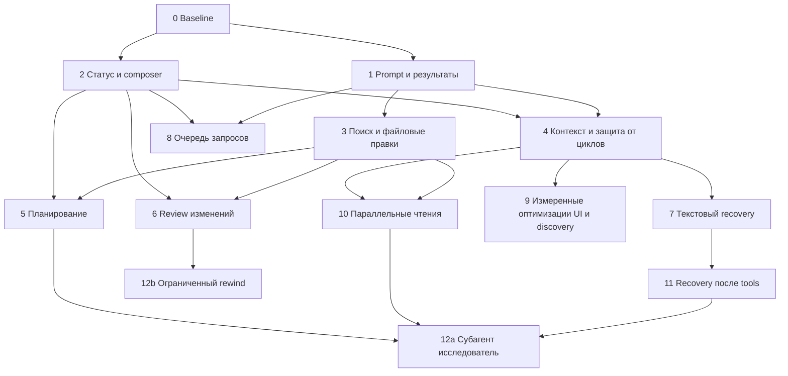

# План внедрения решений ZCode в Runóza

Первый цикл должен сделать существующего агента точнее, понятнее и экономнее: улучшить prompt и файловые инструменты, сократить повторную передачу контекста, показать ход работы и подтверждённые результаты проверок. Затем добавить review изменений и очередь следующих запросов. Субагенты и возврат файлов требуют отдельного этапа устойчивости и не должны задерживать первые полезные поставки.

План объединяет два параллельных исследования: [технические решения агента](zcode-agent-engineering.md) и [UI и UX](zcode-ui-ux.md). Обозначения T1–T12 и UX-01–UX-13 отсылают к предложениям в этих документах. Там находятся подробные основания, commit-pinned ссылки на ZCode и разбор фактической реализации.

Срез — 27 ноября 2026 года: ZCode `a4b4445141eb7d3b3e99eada9292775383bfc44e`, Runóza `921cb0adbfaa7ca1e9e3b4340232c29d358bdd56`. План основан на статическом изучении исходников и тестовых сценариев. Сравнительные прогоны моделей и live-проверка ZCode не выполнялись; оценки выгоды ниже предстоит проверить. В рамках исследования создаются документы, продуктовые изменения не реализуются.

## Статус реализации этапов 0–4

Этапы 0–4 реализованы в текущем рабочем checkout. Подробности контрактов, flags, revisions/retention и воспроизводимого evaluation runner: [coding-evaluation.md](../coding-evaluation.md). Исследовательский срез выше сохранён как основание решения; реализация не означает выполнение отложенных этапов 5–12. Итоговые проверки и ограничения фиксируются отдельно в [отчёте реализации](zcode-stage-0-4-results.md).

## Статус первой части этапа 6

Реализован read-only обзор сохранённых изменений: список записей с пагинацией, ленивый unified diff before/after, переходы из запуска/действия/workspace и возврат к выбранной записи. Источник — immutable revisions этапа 3; доступ проверяется на сервере. Подробности, проверки и ограничения — в [отчёте review](zcode-readonly-review-results.md).

Следующая часть этапа 6 также реализована: выбор стороны/диапазона, «Обсудить выделенное», контекстные ссылки в composer, серверная проверка excerpts, сохранение в истории и live ACL при передаче модели. Подробности миграции 039, регрессии и ограничений — в [отчёте контекстных ссылок](zcode-revision-references-results.md). Live Git, отдельные review threads, rewind, plan mode и очередь не входят в эти поставки. Этапы 5, 7, 8, 9 и 10 реализованы следующими поставками, описанными ниже. Этап 10 остаётся opt-in по результатам измерений. Следующий пункт плана — этап 11: восстановление модели от сохранённой границы инструментов.

## Статус этапа 5

Реализованы версионируемый RunPlan, стабильные шаги и блокировки, серверный режим планирования, редактирование после завершения и явное принятие конкретной версии в новый execution run. Full access и MCP metadata не обходят ограничения; live ACL и target проверяются повторно. Подробности миграции 040, проверок и ограничений — в [отчёте этапа 5](zcode-plan-mode-results.md).

## Статус этапа 7

Реализовано ограниченное восстановление текстового ответа для plain chat и PiAgentRuntime: повтор до первого текста, затем только продолжение суффикса без инструментов, максимум два восстановления на run. Сохраняются попытки, их связи, причины, исходы и общий бюджет с summary; reload и compaction его не сбрасывают. Частичный ответ остаётся монотонным. Любой tool call запрещает восстановление до этапа 11. История попыток доступна в UI и защищённом API. Миграция 041, проверки и ограничения — в [отчёте этапа 7](zcode-text-recovery-results.md).

## Статус этапа 8

Реализована серверная очередь следующих запросов: durable ACK/idempotency, FIFO, revision/CAS для изменений, пауза/возобновление, атомарная связь пункта с новым run и восстановление dispatch после сбоя worker. Доступ, модель, target, версии расширений и references проверяются повторно; устаревший запрос требует внимания. Stop, ошибка и неизвестный исход приостанавливают очередь, включая гонку первого enqueue с завершением. Composer разделяет «Добавить следующим» и Stop; поздний ACK сохраняет новые ревизии и scope черновика. Миграция 042, проверки, API и ограничения — в [отчёте этапа 8](zcode-conversation-queue-results.md).

## Статус этапа 9

Реализованы индексы и переиспользование проекций истории, стабильные props AIKit и отделение history от ввода в composer. На 1000 сообщениях streaming пересчитывает одну проекцию ответа, ввод — ноль; сохранены selection, раскрытые reasoning/tool cards, scroll anchor и актуальные обработчики действий. В каталоге и picker добавлены EN/RU примеры, точные состояния доступности и «Попробовать» с повторной проверкой scope и заполнением черновика без отправки. История показывает безопасную сводку расширений из immutable run snapshot. Виртуализация и новый schema cache не понадобились для выявленного bottleneck; native deferred tools не включались. Полный `npm run check` прошёл: 113 unit, 188 UI/29 файлов, server/web/Electron frontend builds и лицензии. Backend: 190 проверенных сценариев с учётом повтора исправленной fixture, 6 инфраструктурных skips. Измерения, перечень UI-регрессии этапов 0–9 и границы jsdom-проверки — в [отчёте этапа 9](zcode-history-discovery-results.md).

## Статус этапа 10

Реализован `read_batch` для `history_read`, `skills_search`, `mcp_search` и `mcp_schema`: максимум 8 пунктов, 3 in-flight, сериализация одного ресурса, текущие ACL каждого child, частичные ошибки и отмена с ожиданием in-flight чтений. Бюджет и loop guard сохранены; writer не обгоняет batch. Pi остаётся последовательным, дочерние schemas валидируются его публичным `runToolCall`; новые действия не расширяют разрешения. Журнал и EN/RU UI показывают реальные timestamps/исходы; provider history сохраняет call/result соответствие. Контролируемая fixture: 253→94 мс; полный локальный runtime: медиана 638→586 мс с существенным разбросом. Поэтому флаг `RUNOZA_READ_BATCH` выключен по умолчанию и включается явно для новых runs. Проверки: 119 unit, 193 UI/30 файлов, 199 backend passed и 6 инфраструктурных skips, все сборки; подробности и границы измерений — в [отчёте этапа 10](zcode-read-batch-results.md). Изменений схемы нет.

## Статус этапа 11

Реализован durable model journal: подготовленный контекст, fingerprint prompt/модели/схем, assistant batch, intents, точные tool results и связь с generation attempts. Подтверждённая граница восстанавливается через публичный API Pi без повтора сохранённых действий. При неполном batch, неизвестном исходе, частичном новом тексте и изменении конфигурации автоматическое продолжение останавливается. Worker использует новый job ID и lease; старые callbacks и cleanup защищены fencing. Workspace сохраняется на безопасной границе, старый environment fence отзывается. Лимиты, отмена, live ACL и compaction действуют после восстановления. Snapshot/SSE и EN/RU UI показывают раунд, состояние и причину остановки; внутренний контекст модели не выдаётся в snapshot.

Миграция `043_model_journal` обратима. Флаг `RUNOZA_MODEL_JOURNAL` выключен по умолчанию и фиксируется при создании run. Проверки: 122 unit, 197 UI/31 файл, 221 backend passed и 6 инфраструктурных skips; server/web/Electron frontend builds, типы, форматирование и лицензии прошли. Подробности и ограничения — в [отчёте этапа 11](zcode-model-journal-results.md). Следующая развилка — пилоты 12a/12b ниже: они требуют выбора полезного продуктового сценария и проверки критериев включения, а не автоматического включения обоих механизмов.

## Статус этапа 12a

Реализован пилот read-only исследователя: отдельный Pi child со своей задачей и контекстом, durable parent/child metadata, общий бюджет, depth 1, максимум 3 исследования за запуск, 6 модельных попыток и 16 чтений на ребёнка. Жёсткий список чтений не расширяется разрешениями родителя или утверждениями модели. Stop и дедлайн останавливают весь запуск; смена lease блокирует публикацию старого child. Отчёт содержит ссылки на сохранённые чтения и не выдаёт разрешений. Восстановление возможно только после полной границы родительского tool result; незавершённый child автоматически не повторяется. Общий web/Electron UI показывает настоящие исследования, usage, источники и остановку на EN/RU.

Миграция `044_readonly_research` обратима. Требуются оба флага `RUNOZA_RESEARCH=true` и `RUNOZA_MODEL_JOURNAL=true`; по умолчанию исследователь выключен. На контролируемой fixture следующий запрос родителя стал примерно на 46% меньше, но число запросов выросло с 2 до 4, а время увеличилось. Это не основание включать функцию по умолчанию: критерий полезности на реальных задачах остаётся открытым. Проверки: полный `npm run check`, 124 unit, 205 UI/32 файла, полный backend — 250 passed и 6 инфраструктурных skips. Детали реализации, измерений и ограничений проверок — в [отчёте этапа 12a](zcode-readonly-research-results.md). Следующий независимый пилот — **12b, предпросмотр отката управляемых записей**.

## Статус первой части этапа 12b

Реализован read-only предпросмотр отката всего запуска: состояния safe/conflicting/unsupported по текущим байтам и сохранённым версиям, объединение непрерывной цепочки управляемых правок одного пути, переходы к первой/последней записи, live ACL, проверка target/generation, отмена и ограниченный срок результата. Поддерживается замена существующих текстовых файлов; создание, удаление, shell-эффекты, повреждённые/недоступные версии и неоднозначные цепочки отмечены неподдерживаемыми. Preview работает через существующий workspace worker без записи файлов, запуска команд и создания среды. Новый флаг `RUNOZA_ROLLBACK_PREVIEW` выключен по умолчанию; изменений схемы нет.

Проверки: полный `npm run check`, 124 unit, 215 UI/33 файла; полный backend — 280 passed, 0 failed и 6 инфраструктурных skips. Подробности и ограничения — в [отчёте предпросмотра 12b](zcode-rollback-preview-results.md). Применение отката в эту поставку не входит. Следующая часть 12b требует повторной проверки всего набора перед первой записью, точного согласования target/версий, журнала применения и явного результата частичного сбоя; готовый preview не заменяет эти проверки.

## Статус второй части этапа 12b

Добавлено подтверждённое применение отката существующих текстовых файлов: точное подтверждение свежего preview, повторная проверка всего набора перед первой записью, `expectedHash` у каждой записи и durable журнал результатов по файлам. Неизвестный исход не повторяется; частичный сбой сохраняет уже подтверждённые результаты. Cancel останавливает оставшиеся записи, а смена worker/lease блокирует поздние callbacks. Новые запуски и workspace-действия ждут завершения отката; очередь следующих запросов сохраняется, а после частичного/прерванного результата приостанавливается до проверки пользователем.

Общий web/Electron UI получил отдельное подтверждение (первоначальный фокус «Отмена»), версии/пути и журнал применения с отдельной остановкой. Миграция `045_managed_rollback` обратима; новый флаг `RUNOZA_ROLLBACK_APPLY` выключен по умолчанию и требует preview. Отключение функции и downgrade не отменяют уже записанные файлы. Проверки: полный `npm run check`, 124 unit, 224 UI/34 файла; полный backend — 306 passed, 0 failed и 6 инфраструктурных skips. Подробности реализации и ограничений — в [отчёте применения 12b](zcode-rollback-apply-results.md).

## Проверка в запущенном браузере и приложении

После второй части 12b выполнен live smoke в Chrome и отдельном Electron на macOS: обзор изменений, подтверждение/применение отката, конфликт и частичный результат, очередь, план, журналы, темы/языки и узкие экраны. Исправлены обрезание Dialog и ложная ошибка после Stop. Итоговый `npm run check`: 124 unit, 226 UI/34 файла, все проверки прошли. Файловый executor оставался тестовым; реальные OS-записи и шесть инфраструктурных skips этим прогоном не закрыты. Сценарии, доказательства и ограничения — в [отчёте браузера и desktop](zcode-browser-desktop-ui-results.md).

## Решения об архитектуре

Сохраняем PiAgentRuntime, Fastify, PostgreSQL, серверное выполнение агента и общий web/Electron UI на Gravity. Заимствуем отдельные механизмы ZCode через существующие границы Runóza. Полная замена runtime, UI-библиотеки, авторизации или транспорта не нужна для предложенных улучшений.

У Runóza уже есть compaction, история инструментов, сохранение большого вывода, paged reads, skills/MCP discovery, permissions, SSE и файловые записи с `expectedHash`. Работу над ними считать расширением, а не повторным внедрением. Состояние готовности проверять по коду, поскольку старые roadmap-документы могут описывать более ранний этап.

Для всех поставок действуют пять условий:

1. Сервер хранит факты запуска, разрешений и результатов. UI показывает их проекцию; текст модели не становится доказательством исполнения.
2. Run сохраняет версии prompt, выбранных расширений и настроек. Live ACL, отзыв устройства и ограничения организации проверяются перед действием, даже если snapshot старый.
3. `unknown` остаётся отдельным исходом. Повтор модельного запроса, повтор чтения и повтор внешнего действия имеют разные правила.
4. Вложения S3, файлы проекта, виртуальные файлы беседы и файлы workspace — разные сущности с разными способами доступа. Их нельзя объединить одним неявным локальным путём.
5. Локальный host executor и общий серверный терминал сохраняют свои реальные границы. Worktree, относительный путь и режим планирования не объявляются изоляцией операционной системы.

## Порядок поставок

S означает локальное изменение; M — несколько модулей и контрактные проверки; L — новый жизненный цикл, хранение или согласованное изменение обоих executors. Размер не означает срок. Каждый этап завершается демонстрацией конкретного сценария и может быть отдельной поставкой; крупный этап следует разбить на перечисленные PR.

| Этап | Результат                                                 | Основание              | Зависимости                 | Размер   |
| ---- | --------------------------------------------------------- | ---------------------- | --------------------------- | -------- |
| 0    | Baseline и воспроизводимые coding scenarios               | T8, UX-10              | Нет                         | M        |
| 1    | Модульные инструкции и контракт результата проверки       | T1, T6                 | 0                           | M        |
| 2    | Статус работы, понятные approvals и адаптивный composer   | UX-01, UX-07, UX-09    | 0                           | S–M      |
| 3    | Ограниченный поиск, точечная правка и журнал файлов       | T3, UX-04, UX-05       | 1                           | L        |
| 4    | Microcompaction, защита от циклов и честный context meter | T2, T4, UX-03          | 1, каркас UI из 2           | M        |
| 5    | План задачи и серверный режим планирования                | T6, UX-02              | 1–3                         | M–L      |
| 6    | Просмотр изменений и обсуждение строк                     | UX-04, UX-05, UX-08    | 2, 3                        | L        |
| 7    | Ограниченное восстановление текстового ответа             | T5, UX-01              | 1, 4                        | M        |
| 8    | Серверная очередь следующих запросов                      | UX-06                  | 1, 2                        | L        |
| 9    | Производительность истории и удобство расширений          | T9, UX-10, UX-11       | 0, 2, 4                     | M        |
| 10   | Параллельные независимые чтения                           | T7                     | 1, 3, 4                     | M        |
| 11   | Durable model rounds и recovery после tools               | T5                     | 7, контракт результата из 1 | L        |
| 12   | Пилоты read-only субагента и ограниченного rewind         | T10, T11, UX-12, UX-13 | См. условия ниже            | L каждый |

После этапа 0 техническая ветка 1 и UI-ветка 2 независимы. После этого 3 и 4 можно вести параллельно; 6 не требует очереди 8, а 8 не требует rewind. Этапы 9 и 10 допускаются только по измеренной потребности. Проверки доступности и прав сопровождают каждый этап, а не откладываются в конец.

## Этап 0 Зафиксировать качество и стоимость текущего поведения

Создать небольшой набор синтетических репозиториев и сценариев поверх настоящих `packages/agent`, `packages/chat` и executors. Переиспользовать существующие integration fixtures и `tests/unit/provider-recovery.test.ts`, а не строить второй упрощённый agent loop для benchmark. Принцип ZCode — прогон через продуктовый runtime — подтверждён его [runtime-path tests](https://github.com/zai-org/ZCode/blob/a4b4445141eb7d3b3e99eada9292775383bfc44e/apps/zcode-cli/tools/provider-regression/tests/runtime-path.test.ts#L8-L43).

Первый PR — deterministic provider, fault fixtures и отчёт по состояниям. Второй — opt-in runner для реальных моделей с явной конфигурацией, пределом расходов и сохранением результатов после каждого случая. Никакие обычные пользовательские беседы или production workspaces не служат fixtures.

Baseline содержит долю успешно решённых задач, число вызовов модели, input/output/cache usage при наличии, число compactions, повторных чтений, конфликтов и подтверждений; время от запроса до проверенного результата, отдельно ожидание человека. Неполный usage обозначается как недоступный или оценочный. Стоимость успешной задачи учитывает расходы и на неудачные попытки, а не только успешные runs.

Для существующего UI сохранить время открытия рабочей области, число render/geometry reads и поведение прокрутки на фиксированных данных. Первое измерение открытия review появится с его прототипом на этапе 6. Не назначать произвольные проценты ускорения до baseline. Детерминированные correctness cases должны проходить все; качество реальных моделей сравнивается на одинаковых задачах, профилях и числе повторений, с показом размера выборки.

**Готово:** один запуск создаёт отчёт с версиями кода/prompt/model profile, результатом каждого случая и причинами `not_run`; прерывание не теряет уже записанные результаты. Добавление метрик проходит через allowlist `packages/telemetry/src/index.ts`, без исходного кода, prompt, команд и секретов в обычных spans.

## Этап 1 Уточнить поведение агента и факты завершения

Выделить `packages/agent/src/prompt.ts` из `AGENT_SYSTEM_PROMPT`: устойчивые инструкции, coding guidance, сведения о target, политика разрешений, восстановление контекста и расширения. Это предлагаемый новый файл. Собирать секции из run snapshot, сохранять версию builder и стабильный порядок. Не добавлять provider-specific cache parameters без поддержки в адаптере.

Одновременно согласовать описания tools с реальными permissions. В prompt не должно быть противоречия между «каждый вызов требует вопроса» и существующими grants/full access. Сохранить право отвечать без tools в обычном разговоре. Адаптированный образец поведения приведён в T1 и разделе с примером инструкций технического документа.

Второй PR вводит небольшой `RunVerification` contract: `actionId`, тип проверки, наблюдаемый исход `passed / failed / not_run / unknown`, exit code и ссылку на результат. Exit code 0 означает успешность конкретной команды, а не автоматическое выполнение всех требований задачи. Название и область проверки должны быть видны; LLM-review при необходимости остаётся отдельной оценкой. Для текстового ответа или простой правки документа не навязывать проверяющую модель.

Точки: `packages/agent/src/index.ts`, `packages/chat/src/index.ts`, `packages/contracts/src/chat.ts`, `packages/providers`, новая append-only migration при необходимости. Контракты вводить по фактической потребности этапа, без преждевременной универсальной event platform.

**Готово:** одинаковый snapshot даёт одинаковый prompt; недоступные инструменты не рекламируются; locale и target корректны; completion card не красит незапущенный тест в зелёный; unknown остаётся видимым. Baseline не ухудшается на plain chat и на отказе доступа.

## Этап 2 Показать текущую работу на существующих данных

Вынести общую view model из `RunActivity`, `CodeActivity` и условий `ChatWorkspace`. Над composer разместить компактную строку статуса: запуск, ожидание разрешения/среды, compaction, ошибка или завершение. По нажатию открывать подробности и переход к конкретному действию. Место выполнения показывать там, где оно объясняет поведение.

В approval card сначала видны действие, ресурс, target и scope; длинные аргументы раскрываются. Сохранить черновик, курсор и предыдущее место фокуса. В нескольких ожидающих запросах не перехватывать фокус по очереди без действия пользователя. `aria-live` сообщает значимую смену состояния, а не каждый токен или тик таймера.

У composer задать порядок сокращения подписей по ширине, сохраняя Send/Stop, target и доступ к настройкам. Применить существующие Gravity components и semantic tokens; не переносить глобальное подавление focus styles ZCode. Тёмная/светлая тема, RU/EN, IME, keyboard и 200% zoom входят в поставку.

**Готово:** reload и SSE reconnect показывают тот же статус; старые messages с `parts=null` работают; ошибка видна при свёрнутых деталях; действия доступны на 390 px и в Electron; переключение беседы не теряет черновик и не показывает старое разрешение как новое. Проценты выполнения по времени или числу токенов отсутствуют.

## Этап 3 Сделать поиск и правки кода точными

Разбить на три PR.

1. Добавить ограниченный `workspace_search`: относительный корень, glob, запрос, лимит совпадений/bytes, результат с путём и строками, явный `truncated`. Он ищет по выбранному executor workspace. Существующий `files_search` остаётся поиском по виртуальным файлам беседы.
2. Добавить single-file `edit_file` с `expectedHash`, точным старым и новым фрагментом и проверкой однозначности. Сначала exact match; multi-file patch и fuzzy matching отложить. Подтверждение связано с точными аргументами и версией; конфликт требует нового чтения и пересчёта.
3. Сохранять запись изменения: `runId/actionId`, workspace, path, before/after digest и содержимое обеих revisions либо patch с восстановимой базой, способ изменения и степень достоверности атрибуции. Hash сам по себе не восстанавливает исторический diff. Подготавливать данные для review на этапе записи, а не пытаться восстановить их после завершения. Если содержимое не сохранено из-за policy, лимита или ошибки, фиксировать `unavailable` без подстановки текущего файла. Ошибка сохранения review-артефакта после записи не означает, что сама правка не выполнена, и не разрешает её повторить.

Усилить запись в `packages/execution/src/files.ts` и desktop adapter. Текущие `os.write`/`ftruncate` не являются атомарной заменой. Для управляемых writers нужны сериализация и проверка версии в критической секции; подготовленный файл должен становиться видим целиком. Простые hash-check и rename не дают универсального filesystem CAS относительно любого внешнего редактора. Сохранить root/symlink checks и документировать ограничение неконтролируемой конкурентной записи. Crash-тест проверяет отсутствие частично видимого результата; conflict-тест — отказ при обнаруженном изменении.

Shell может менять файлы вне структурного инструмента. Для таких изменений отдельно определить наблюдение baseline/after на безопасной границе и бюджет сканирования. Если авторство не установлено, показывать «наблюдаемое изменение workspace», а не «правка агента». Не снимать без ограничений копию всех секретов, build outputs и больших бинарников. Отмечать неполное покрытие.

Точки: `packages/agent`, `packages/execution/src/files.ts`, `packages/execution/src/desktop.ts`, `apps/desktop`, contracts, storage через действующий proxy и новая migration. Новые revisions имеют ACL и retention; сохранение результата не открывает прямой доступ к S3.

**Готово:** stale hash, два совпадения, CRLF/BOM/Unicode, symlink escape, отмена, сбой записи и конфликт управляемых writers проверены на обоих executor contracts. Tool возвращает новый hash и ссылку на запись изменения. Никаких обещаний универсального отката shell-эффектов.

## Этап 4 Сократить рабочий контекст без потери доказательств

Перед `compactContext` в `packages/chat/src/context.ts` добавить microcompaction модельной проекции. Старое тело tool result заменяется короткой записью об исходе с `actionId` и доступной ссылкой чтения. Очищать только результаты, полный экземпляр которых уже сохранён. Сохранить ошибки, `unknown`, активные обязательства, недавние существенные результаты и целостность tool batches. UI-история не меняется.

Сочетать токенный бюджет с текущими char/byte ceilings. Добавить bounded guard повторных одинаковых failures и быстрого повторного заполнения после compaction. Guard сначала предлагает изменить действие, затем останавливает исчерпавшую бюджет работу с объяснением. Нормальный polling и чтение новой версии файла не считаются зацикливанием.

Расширить `ConversationInfo` и composer небольшим context meter: оценка следующего запроса отдельно от usage прошлого, резерв ответа и источник чисел. Кнопка сжатия использует существующий endpoint и показывает pending/running/completed/failed. Не выдавать суммарные токены беседы за занятость окна; неизвестные breakdown/cache значения не подменять нулём.

**Готово:** после cold resume ссылки работают с live ACL; marker не побуждает повторять mutation; repeated compaction не стирает цель; смена model profile пересчитывает бюджет. На длинном чтении число summary calls и стоимость сравниваются с baseline при сохранении результата задачи. Отключение оптимизации возвращает прежний путь без потери истории.

## Этап 5 Связать план с действиями и разрешённым режимом

Первая поставка — небольшой durable `RunPlan` с версией, пунктами со стабильными ID и состояниями. Отображать текущий пункт и причину блокировки; не переставлять строки при смене статуса. Список плана выражает намерения агента, а факты проверок из этапа 1 показываются отдельно.

Вторая поставка — «Сначала составить план». Это отдельный capability ceiling серверного run, не косметический переключатель. В MVP доступны только структурные операции чтения с известными свойствами. Произвольный `execute` не становится read-only от инструкции модели; MCP `readOnlyHint` не отменяет политику Runóza. Tool dispatch проверяет потолок режима даже при наличии старого широкого grant.

«Приступить» создаёт новый запуск со ссылкой на выбранную версию плана, текущим snapshot и обычными проверками доступа. Согласие с планом не расширяет scope разрешений. Планирование не требуется для каждого простого запроса.

**Готово:** план переживает reload; правка плана инвалидирует принятие старой версии; невозможно записать файл или вызвать mutating MCP через plan run; отзыв доступа действует между планом и выполнением; недоступная среда не заменяется другой незаметно.

## Этап 6 Дать пользователю проверку изменений и точные ссылки

Создать read-only обзор «Изменения запуска» на данных этапа 3: список файлов, additions/deletions при наличии, причина отсутствия diff, отдельные состояния partial/final/unavailable. Полный patch загружать при раскрытии. Старый run открывает сохранённую версию. Текущее состояние Git показывать как отдельный источник с явной подписью.

В `CodeWorkspace` добавить раздел «Изменения», открытие файла/строки из tool result и сохранение позиции по org/user/conversation/workspace. На узком экране использовать полноширинную рабочую область с возвратом в чат. Скрытие панели не завершает PTY; закрытие терминала остаётся отдельным действием.

В composer добавить context reference из файла или diff: источник, workspace, path, revision/hash, диапазон и сторона сравнения. Сначала кнопка «Обсудить выделенное» и picker; полноценный rich-text editor и drag-and-drop не обязательны. Сервер проверяет доступ, строит ограниченный excerpt и сериализует его для модели. Чип не включает весь большой файл автоматически.

**Готово:** исходно dirty repository, внешние изменения, бинарный файл, удалённый источник и offline target показаны честно. Комментарий к левой стороне diff не привязывается к правой. Изменённый источник требует актуализации; поздний ответ другого workspace не попадает в текущий preview. После просмотра diff пользователь возвращается к тому же месту в чате.

## Этап 7 Восстановить только безопасную часть ответа

Начать с continuation при output limit без tool calls и recovery оборванного текста до исполнения tools. У каждой попытки есть identity, причина, budget и связь с предыдущей. Не объединять незавершённый JSON вызова инструмента и не повторять предыдущую команду. Общий лимит run включает continuation, summary и retries; счётчик не обнуляется из-за reconnect или compaction.

Согласовать recovery с существующим монотонным transcript: сохранённый частичный текст нельзя тихо переписать задним числом. UI видит попытки и их исход; новая генерация не дублируется в итоговом ответе. Ошибка восстановления оставляет понятный partial result.

**Готово:** fault injection до первого token, после текста, на output limit, при cancellation/backoff и при отсутствии usage; bounded attempts сохраняются после reload. Текущий запрет неоднозначного replay после tools остаётся до этапа 11. Не увеличивать глобальный `maxRetries` как замену этому протоколу.

## Этап 8 Добавить очередь продолжений с подтверждённым приёмом

Существующее состояние `chat_runs.status=queued` означает ожидание исполнения уже созданного run. Новая очередь — намерения пользователя на следующие ходы беседы. Не отменять нынешний запрет двух активных runs в одной беседе простым удалением `RUN_ACTIVE`.

Добавить `ConversationQueuedInput` как предлагаемый contract: idempotency key, автор, revision, текст и references, выбранные model/target/extensions, порядок и статус. MVP поддерживает добавить, удалить, отредактировать через compare-and-swap и приостановить/возобновить очередь. Принятый пункт становится run атомарно на границе завершения предыдущего; ACL, доступность target и расширений проверяются снова.

В UI во время работы явно разделить «Добавить следующим» и «Остановить». После ACK очищать только отправленную ревизию draft в исходном scope; новый текст, введённый за время запроса, и draft другой беседы сохранять. При потерянном ACK показывать неопределённость и сверять по idempotency key. После ручной остановки текущего run в MVP приостанавливать автозапуск очереди, чтобы следующий запрос не стартовал вопреки ожиданию пользователя. Ошибка/неизвестный исход также требует явного решения о продолжении. `Send now` с принудительным прерыванием и DnD отложить.

**Готово:** два клиента, double click, редактирование одновременно с claim, падение worker и потерянный ACK не теряют запрос и не создают два run. Сценарий «enqueue → новый текст или смена беседы → поздний ACK» сохраняет актуальный draft. Неактуальная модель/версия/устройство переводит пункт в `needs_attention`; не происходит скрытой подстановки. История показывает исходный текст принятого пункта и реально использованный snapshot.

## Этап 9 Оптимизировать историю и discovery по измерениям

По baseline отделить стабильные сообщения от активного streaming turn, устранить лишние подписки и повторные загрузки. Виртуализацию вводить там, где она действительно уменьшает работу, сохранив scroll anchor, раскрытие карточек, выделение текста и доступность. Начальный regression fixture — 1000 сообщений с длинными результатами; реальные поддерживаемые ограничения API учитываются отдельно.

Для skills/MCP дополнить текущий каталог примерами запросов и ясными состояниями installed/enabled/authorized/available. «Попробовать» подставляет текст и доступную ссылку, но не отправляет запрос. Показывать, что включено в конкретный run, не путать это с текущими настройками каталога.

Оптимизировать schema exposure и cache только после измерения повторных загрузок: ключи включают tenant/user/connection/version, live ACL остаётся обязательным. Native deferred tools — отдельная capability с работающим fallback, не изменение базового протокола для всех моделей.

**Готово:** чтение старой истории не сбивается от новых токенов; Stop и ввод остаются отзывчивыми; изменение scope очищает чужой cache; отключённое расширение не выглядит доступным; immutable run не меняется после обновления каталога. Приложены числовые измерения до/после, а не только скриншоты.

## Этап 10 Ограниченно параллелить независимые чтения

Серверный descriptor tool определяет класс эффекта, ресурс, отмену и допустимую concurrency. Начать с метаданных, схем и страниц сохранённых результатов. Не запускать произвольный shell или mutating MCP параллельно на основании слов модели. Общая MCP-сессия или workspace lease могут требовать дополнительной сериализации даже для чтения.

Использовать штатный Pi hook при наличии нужного контракта; иначе ограниченный batch tool для перечисленных чтений. Не форкать Pi и не включать глобальный parallel режим ради первых измерений. UI сохраняет реальную хронологию старта/окончания, provider history — корректное соответствие call/result.

**Готово:** лимит in-flight, отмена всего batch, live ACL каждого call, частичная ошибка и зависимость read→write проверены. Writer не обгоняет зависимое чтение. Ускорение оправдывает дополнительную нагрузку по данным baseline; если нет, оптимизация остаётся выключенной.

## Этап 11 Восстанавливать модель от сохранённой границы инструментов

Добавить durable model round: версия prompt и схем, assistant tool-call batch, подтверждённые результаты, usage/attempt и committed boundary. Сохранение связано с текущим lease; поздний worker не может продвинуть чужой run. `code_actions` по-прежнему хранит исход исполнения, а model journal — что допустимо повторно передать модели.

После сбоя сначала сверить ledger, затем построить provider-valid history. Известное выполненное действие не запускается снова. Незавершённое действие с неизвестным внешним исходом требует разрешённой проверки состояния или человека. Если восстановить модельную границу нельзя, завершить run с доступными результатами, а не продолжать по догадке.

**Готово:** сбой между side effect и сохранением результата, worker restart, lease takeover, несколько calls в batch, cancellation и compact/resume не дают двойную mutation. Snapshot и UI раскрывают границу восстановления. Неполный tool batch не отправляется провайдеру как валидная история.

## Этап 12 Провести два независимых пилота

**12a Read-only исследователь.** После этапов 5, 10 и 11 ввести parent/child runs с общим бюджетом, наследуемым потолком capabilities, ограниченной глубиной и cancellation. Child выдаёт компактный вывод с ссылками на доказательства. Его результат — данные для основного агента, не пользовательское разрешение. UI UX-12 отображает реально существующего исполнителя и корректный Stop. Одновременные writers и большой workflow engine не входят в пилот.

**12b Возврат поддерживаемых файлов.** После этапов 3 и 6 добавить preview возврата с перечнем safe/conflicting/unsupported файлов, before/after revisions и повторной проверкой при применении. В MVP только поддерживаемые структурные файловые операции; при любом конфликте до начала применения ничего не менять. Если операция охватывает несколько файлов, нужен журнал прогресса и явный исход частичного сбоя — файловая система не даёт общей транзакции автоматически. Fork чата, возврат файлов и внешние эффекты остаются разными действиями.

**Критерий включения обоих пилотов:** основная coding suite уже стабильна, продуктовый сценарий подтверждает пользу, лимиты и отмена работают, отсутствуют открытые дефекты потери данных или расширения прав. Иначе оставить их в backlog. Названия и порядок этих пилотов не создают обязательство внедрить весь функциональный объём ZCode.

## Общие сценарии приёмки

| Сценарий                                                   | Что проверять                                                                                         |
| ---------------------------------------------------------- | ----------------------------------------------------------------------------------------------------- |
| Небольшой bugfix при существующих пользовательских правках | Нужный тест проходит; unrelated файл не изменён; review правильно ограничивает авторство              |
| Связанная правка нескольких модулей                        | Выполнены требования и релевантные проверки; нет ложного общего success только по одному exit code    |
| Длинный вывод и compaction в середине работы               | Полный результат доступен; решения и неизвестные исходы сохранены; нет повторной mutation ради вывода |
| Устаревший файл или reference                              | Конфликт показан до обнаруживаемого несогласованного изменения; неверный excerpt не принят молча      |
| Сбой модели или worker на разных границах                  | Attempts ограничены; текст не дублируется; внешнее действие не повторяется вслепую                    |
| Отмена, отзыв ACL или отключение устройства                | Новые действия прекращаются; состояние очереди понятно; target не подменён                            |
| Два клиента редактируют очередь                            | CAS и idempotency сохраняют один принятый запрос и один запуск                                        |
| Содержимое файла пытается расширить права                  | Plan/capability ceiling и live ACL остаются действующими                                              |
| 1000 сообщений и большие tool results                      | Сохранён scroll anchor; ввод и Stop доступны; lazy diff не грузит всё сразу                           |
| Несколько одинаковых имён файлов и расширений              | Источник, scope и версия различимы; контекст другого пользователя не выдан                            |
| Старые записи без новых полей                              | История, fork и read-only review работают без искусственного восстановления неизвестных фактов        |

Каждая UI-поставка проверяется на web и собранном Electron, RU/EN, light/dark, узком и широком экранах, с клавиатурой и screen reader smoke. Проверки записи и recovery проходят через оба executor contracts; локальные ОС считаются поддержанными только после их smoke tests. Реальные модели дополняют детерминированные проверки, а не заменяют их.

## Выпуск и откат

Вводить оптимизации отдельными серверными feature flags с понятным владельцем поведения. Новые migrations добавлять после актуальной версии при реализации; на исследуемом HEAD последняя — `037_agent_files`. Не резервировать номера сейчас и не переписывать применённые миграции. Новые поля сначала optional; старые clients/snapshots сохраняют читаемость.

Откат обычно означает отключение новой функции, а не удаление сохранённых данных. Отключение очереди запрещает новый enqueue и приостанавливает pending items с явным уведомлением; не теряет их. Отключение edits/recovery оставляет журнал и результаты доступными. Перед миграцией существующей установки — проверка обновления на копии и восстановимый backup по действующему runbook.

Для каждого PR: конкретный пользовательский сценарий, изменяемые контракты, релевантные unit/UI/integration checks, сведения о migration и flag. Перед выпуском — действующие `npm run check`, integration scenarios изменённых областей и общий smoke. Проверка, которую пропустили, называется `not_run`, а не PASS. У ZCode [скрипт affected-tests](https://github.com/zai-org/ZCode/blob/a4b4445141eb7d3b3e99eada9292775383bfc44e/scripts/run-affected-engineering-tests.mjs#L100-L108) при выборе всего suite может пропустить его с exit 0; эту семантику нельзя брать за release gate Runóza.

Если будет переноситься исходный код, а не только идея, фиксировать конкретные файлы/commit и относящиеся к ним LICENSE/NOTICE в существующем процессе учёта зависимостей. Не импортировать весь набор библиотек, hooks и patches ZCode ради одного поведения.

## Рекомендуемый объём первого цикла

Довести этапы **0–4**, затем **read-only review из 6**. Это даёт измеримый результат: агент находит и правит нужный фрагмент, реже повторяет большой контекст, пользователь видит текущую работу и может проверить сохранённые изменения. Пункты плана и verification из 1/5 можно подключать по готовности контрактов; полный plan mode, очередь и recovery выпускать отдельными следующими поставками.

Главный критерий продолжения — больше задач с проверенным результатом при понятной стоимости и меньшем количестве потерянных действий пользователя. Визуальное сходство с ZCode, число новых настроек и само наличие нескольких агентов не являются критериями успеха.
